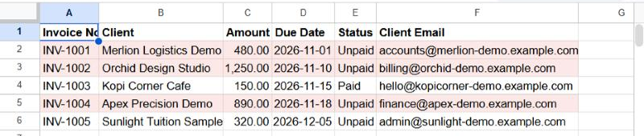

# Google Sheets Invoice Tracker (Apps Script sample)

A small automation for a Google Sheet called `Invoice Tracker`. It adds an **Invoice Tools** menu with four actions:

1. **Highlight Overdue Unpaid Rows**: any unpaid invoice with a past due date turns light red; paid and upcoming rows reset to white.
2. **Email Me Unpaid & Overdue Summary**: emails the sheet owner a digest of open invoices and the total outstanding.
3. **Setup Daily 8 AM Trigger**: installs one daily trigger that runs both checks (it replaces an older copy instead of duplicating).
4. **Insert Demo Data (empty tab only)**: fills the tab with five made-up invoices, with due dates relative to today. It refuses to run if the tab already has data.

## Setup

1. Create a new Google Sheet.
2. Open Extensions > Apps Script, replace the default code with `Code.gs`, and save.
3. Reload the sheet; the **Invoice Tools** menu appears. Run **Insert Demo Data** (or rename the first tab to `Invoice Tracker` and enter your own rows under these headers: Invoice No, Client, Amount, Due Date, Status, Client Email).
4. The first run asks for permission. Google shows an "unverified app" notice for personal scripts; that is normal.

## What was tested

Tested on 21 Nov 2026 in a live Google Sheet (Singapore time zone):

- Insert Demo Data created the five rows, bold headers, number and date formats, and renamed the first tab.
- Highlight shaded the three overdue unpaid invoices and left the paid invoice and the not-yet-due invoice white (screenshot above).
- Email Summary arrived with the three overdue invoices, the one open invoice, and the correct total (S$2,940.00); the paid invoice was left out.
- Setup Daily Trigger created one time-based trigger; running it a second time still left one trigger (no duplicates). The test trigger was deleted afterwards.
- Not tested: waiting for the 8 AM run itself.

## About this sample

Written with AI-assisted tools, then run and checked by me. All names and emails are made-up demo data.
